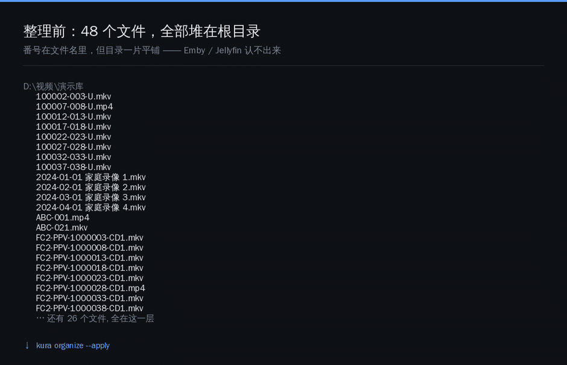
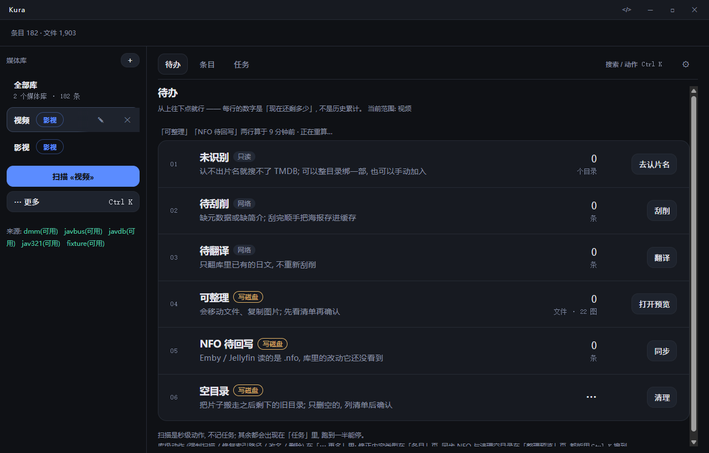
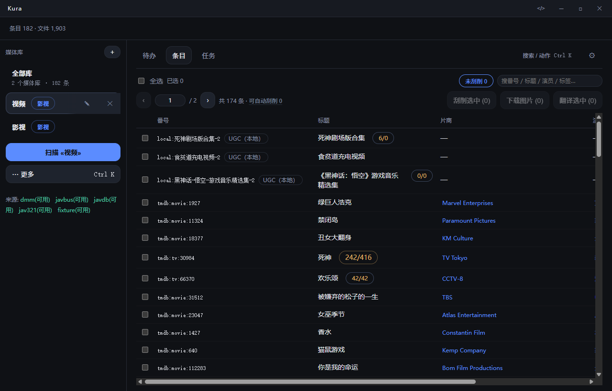
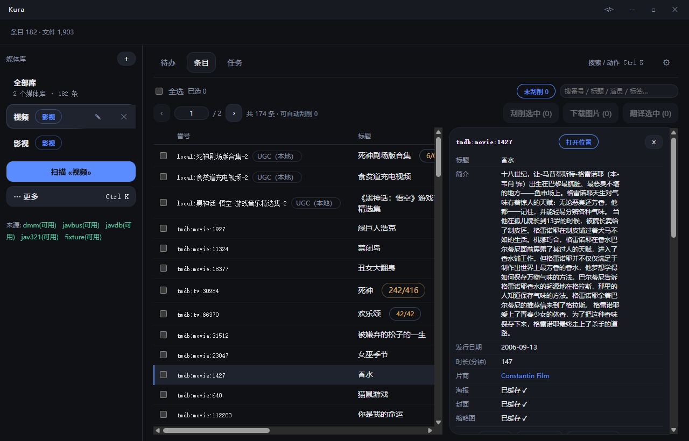
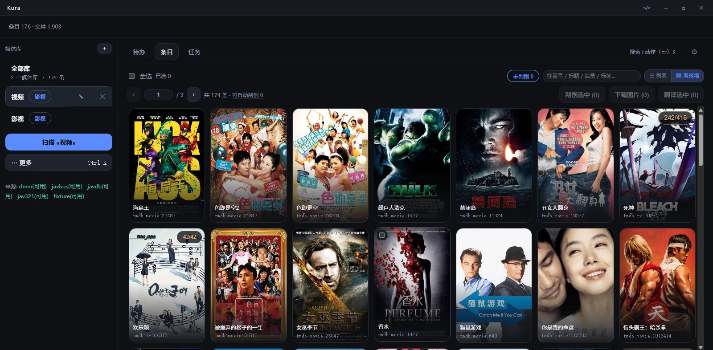
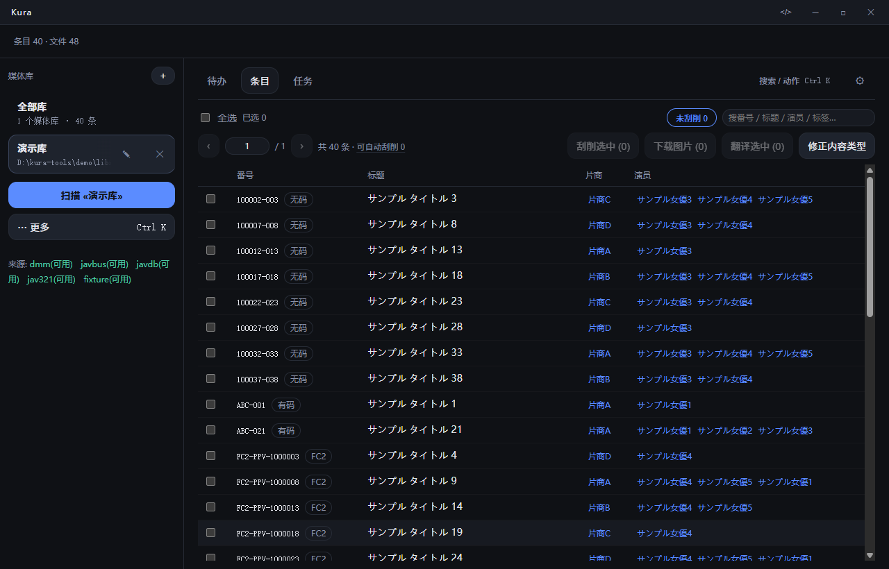
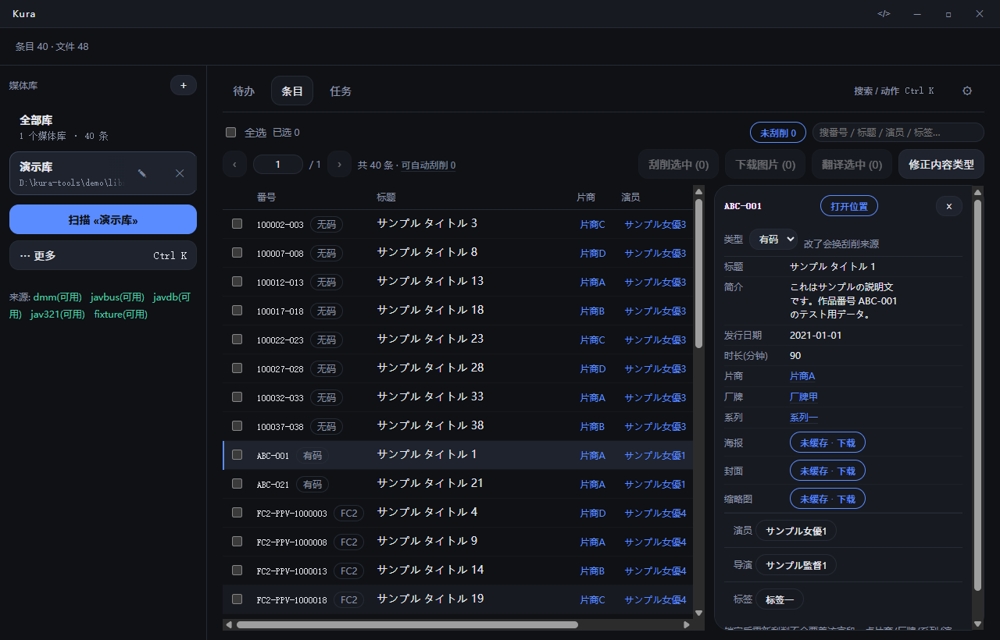
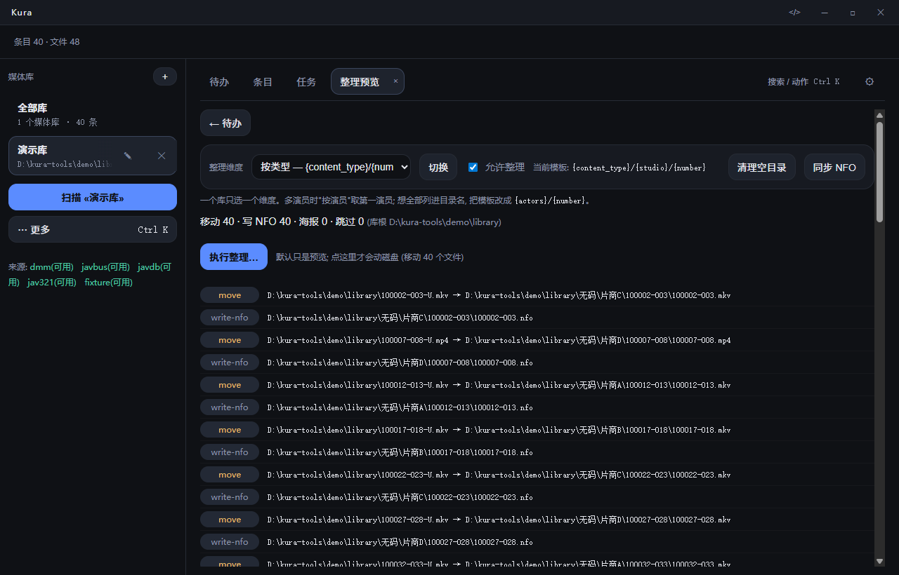
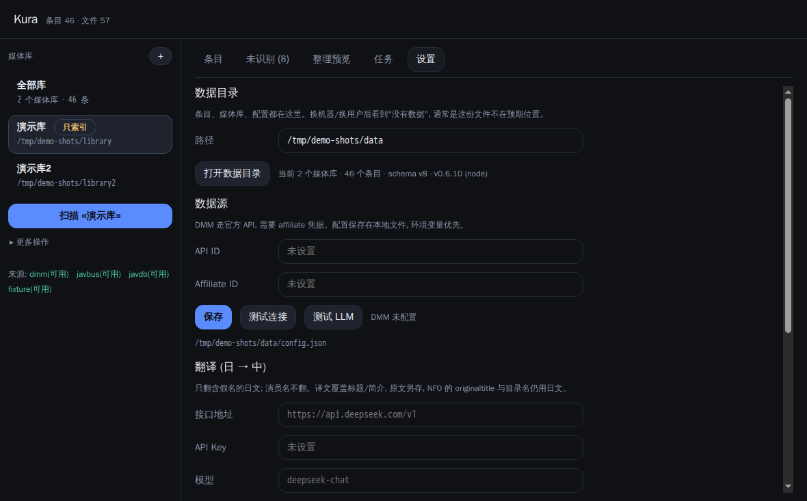

<p align="center"></p>

<h1 align="center">Kura</h1>

<p align="center">A local media library manager for two kinds of libraries:<br>
<b>general video</b> (movies / TV / anime / variety) and <b>numbered</b> (Japanese adult video).<br>
Windows desktop app + an agent-facing CLI, sharing one TypeScript core and one SQLite file.</p>

<p align="center">
  <a href="https://github.com/p-nickzhang-q/kura/releases/latest"></a>
  <a href="LICENSE"></a>
</p>

**[中文](README.md) · English**

> **Heads up: the UI is Chinese-only.** No i18n, by design — both target audiences are
> Chinese/Japanese-speaking. But everything a script or an agent needs is language-neutral:
> the CLI takes flags, returns JSON (`kura schema --json` describes itself), and the **exit code
> is the primary signal**. If you only want the CLI, the Chinese UI never gets in your way.

---

- **No server, no daemon.** It runs when you open it, and exits when you close it.
- **The CLI is a single static binary** — ~40ms cold start, zero dependencies.
- GUI and CLI never talk over a port. They share one SQLite file.
- **The three actions never trigger each other**: `scan` (disk only) → `scrape` (network only) →
  `organize` (dry-run by default; `--apply` touches your files).

## What it does

48 files piled up in the root directory → 55 directories. Video and its NFO move together;
anything it can't identify stays exactly where it is:



## Why it might be interesting

- **It writes NFO *and* reads it back.** Point a second machine at the same drive and
  `kura nfo recover` rebuilds the whole library from the `.nfo` files already sitting on disk —
  no re-scraping, no re-matching. The reader only accepts a whitelist of fields, so playback state
  (`<playcount>`, `<watched>`, `<resume>`) written by Emby can never leak in.
- **Field-level provenance.** Every field remembers which source gave it (`javbus` / `javdb` /
  `dmm` / `tmdb` / `nfo` / manual). You can lock a field; a re-scrape won't overwrite it.
- **Dry-run by default, everywhere.** `organize` prints the plan; nothing moves until `--apply`.
  A rename where the target exists is always `skip`, never overwrite.
- **An agent-facing CLI.** `kura schema --json` is the command list; exit codes are
  `0 / 2 / 3 / 4 / 5 / 10` (ok / usage / retryable / needs-a-human / not-found / bug);
  stdout carries data, stderr carries logs.

## Screenshots

**To-do** — the default page. Each row is one action, and the number is "how much is left right now":



**General video library** (list / detail). Identity is a TMDB id; episode counts show `on disk / declared`:





**Poster wall** — the items page has a second view. The list is for reading fields and doing
batch work; the wall is for finding something to watch:



Artwork comes from Kura's own download cache first, then from an existing `poster.jpg` /
`folder.jpg` already sitting in the library. Only when both are missing does it draw a
placeholder (the first letter of the title) — not a grey box that looks like a load error.

**Numbered library** (list / detail). Fields are tracked per source and can be locked individually:





**Organize preview** — plan first, disk second:



**Settings** — data directory, source credentials, translation endpoint, proxy, update check:



## CLI

`kura --help` for the overview, `kura schema --json` for the machine-readable list.
Argument parsing, `--help` and `schema` are all derived from **one declaration**, so they can't drift apart.

**Global flags**: `--json` (machine channel; auto-on when not a TTY) · `--stream` (JSONL events) ·
`--data-dir <path>` · `--yes`

### Libraries

| Command | What it does |
|---|---|
| `library list` | List libraries (name / root / domain / file count / organize enabled) |
| `library add <name> <root> [--domain av\|video] [--no-organize]` | Create. **The domain is fixed at creation time** |
| `library rename <lib> --to <name>` | Rename (collisions error out; no silent suffixing) |
| `library relocate <lib> <newRoot> [--apply]` | After a disk swap: rewrite indexed paths, move nothing |
| `library set-template <lib> --dimension <dim>` | Switch to a preset organize dimension |
| `library set-template <lib> --template '<tpl>'` | Custom template, e.g. `'{actor}/{year}/{number}'` |
| `library set-organize <lib> --no-organize` | Index-only mode: never moves, renames, or creates directories |
| `library repair-paths [lib] [--apply]` | Fix stale indexed paths after a manual move |
| `library remove <lib>` | Delete the library. **Index only — files untouched, items kept** |

Dimensions: `number` `actor` `actors` `studio` `label` `series` `content_type` `year`.

### Scan and scrape

| Command | What it does |
|---|---|
| `scan <lib> [--dry-run] [--force]` | Disk only: register files, parse numbers, create item stubs. `--force` allows removing >30% of registered files |
| `scrape <number> [--source a,b] [--dry-run]` | Network only: multi-source, field-by-field best pick, snapshot saved |
| `scrape <number> --type <type>` | Items without a number need an explicit type |
| `scrape --pending [--limit N] [--retry-failed]` | Batch: everything still missing a title |
| `scrape --library <videoLib>` | Scrape a video library via TMDB |

### Organize and NFO

| Command | What it does |
|---|---|
| `organize <lib> [--apply]` | **Dry-run by default.** Lists move / write-nfo / copy-image / skip. `--apply` touches disk |
| `nfo sync [lib\|number] [--apply] [--include-unscraped] [--limit N]` | **Two-way**: no network source → fill gaps from NFO; has one → write back (only fields Kura knows, the rest is preserved byte for byte) |
| `nfo write` / `nfo import` | Write-only / read-only |
| `nfo recover <videoLib> [--apply]` | Rebuild items from the TMDB ids found in on-disk `.nfo` files |
| `cleanup [lib] [--apply]` | Delete directories left holding nothing but a poster and an NFO |

### Items

| Command | What it does |
|---|---|
| `item list [--library L] [--state unscraped\|scraped\|exhausted] [--limit N] [--offset N]` | Paged list |
| `item list [--type] [--actor] [--studio] [--label] [--series] [--director] [--tag] [-q kw]` | Filters, combinable |
| `item list --sort number\|title\|release\|studio\|duration\|updated [--desc]` | Sorting; empty values always sort last |
| `item get <number>` | Full metadata plus the per-field source |
| `item set <number> --title … --plot … --actors a,b` | Manual edit; **auto-locks** what you touched |
| `item lock <number> title,plot` / `item unlock …` | Locked fields survive re-scraping |
| `item retype <number> <type>` | Change content type (drives scrape routing and `{content_type}` paths) |
| `item retype --detect [--apply]` | Find every item the current parser would classify differently |
| `item merge <from> --into <to>` | Merge two items for the same film (movies only) |

### Binding files (video libraries)

| Command | What it does |
|---|---|
| `file list [--library L] [--unparsed] [--limit N]` | Indexed files |
| `file reveal <number>` | Where this item lives on disk |
| `file dirs` | Pending bindings (files per directory, how many have a parseable episode) |
| `file bind <dir> --tmdb tmdb:tv:1399 [--season N]` | Bind a whole directory to a TMDB identity, then scrape it |
| `file bind <dir> --local [--title N] [--type movie\|tv]` | **Add manually**: `local:` identity, tagged UGC, no source |
| `file unbind <dir>` | Unbind |
| `file set-season <dir> --season N` | Force a season (one show split across directories) |
| `file set-episode <path> --episode N` / `file clear-episode <path>` | Fix a single episode number |

### Everything else

| Command | What it does |
|---|---|
| `resource fetch <number>` | Download poster (portrait) + thumb (landscape) into the local cache |
| `translate <number>` / `translate --pending [--limit N]` | Japanese → Chinese, title and plot only |
| `translate --repair` | Rebuild "translated but not recorded" items from the local cache (no requests) |
| `source list` | Per-source status and what config is missing |
| `source test <id> [--probe number]` | One command to verify credentials and parsing |
| `task list [--limit N]` | Recent tasks |
| `task show <id>` / `task retry <id>` / `task cancel <id>` / `task delete <id>` | Task detail, retry, cancel, delete |
| `config get` | Read config (**secrets masked**) |
| `config set --tmdb-api-key …` | TMDB key (the only video-library source) |
| `config set --dmm-api-id … --dmm-affiliate-id …` | DMM credentials |
| `config set --llm-base-url … --llm-api-key … --llm-model …` | Any OpenAI-compatible endpoint |
| `config set --translate / --no-translate` | Auto-translate after scrape |
| `config set --save-images / --no-save-images` | Copy images next to the video (default on) |
| `config set --proxy auto\|http://…\|''` | Proxy: `auto` probes common ports, empty follows the system |
| `config test-llm` | Actually send one model request |
| `config path` | Where the config file is |
| `doctor` | Self-check: data dir, database, driver, schema version, counts |
| `version` · `schema` | Version · machine-readable command list |

### Exit codes

`0` ok · `2` usage error · `3` retryable · `4` needs a human · `5` not found · `10` internal bug

The exit code is the primary signal, not the text on stdout. stdout carries data; logs go to stderr.

## Two kinds of libraries

One library belongs to exactly one domain, **chosen at creation and immutable** — it decides
recognition, sources, and the organize shape.

| | General video (`video`) | Numbered (`av`) |
|---|---|---|
| Identity | **TMDB id** | The number in the filename |
| Sources | TMDB | DMM / JavBus / JavDB |
| Recognition | Directory = one show, filename gives season/episode; a movie = no episode anywhere in the directory | Regex + content-type heuristics |
| Organize shape | `Show (Year)/Season 01/Show - S01E01.mkv` · `Movie (Year)/Movie (Year).mkv` | `{dimension}/{number}` |
| When it can't tell | Goes to the "unrecognized" tree, **left for a human to bind** (never guessed) | Goes to the "unrecognized" page; rename and rescan |

**The video domain does not guess.** Filenames are written in too many ways, and a wrong guess
renames a whole season. Recognition covers a small set of forms; everything else is left to you,
and TMDB search results are always picked by a human.

## Data sources

| Source | Status | Notes |
|---|---|---|
| `tmdb` | **works** | The only video-library source; free API key |
| `dmm` | **works** | Official DMM/FANZA API, needs affiliate credentials |
| `javbus` | **works** | HTML parsing, verified against real pages |
| `javdb` | **works** | HTML parsing. Currently behind a **Cloudflare challenge**: datacenter IPs get 403; uncensored entries need a login |
| `fixture` | works | Reads offline samples from a directory; used by tests |

Missing credentials exit with **4 (NEEDS_INPUT)** rather than silently returning an empty item.

## Install

**[Releases](https://github.com/p-nickzhang-q/kura/releases/latest)**

| Artifact | What it is |
|---|---|
| `Kura-x.y.z-setup.exe` | Windows installer (choose directory, shortcuts, uninstaller) |
| `Kura-x.y.z-portable.exe` | Portable, double-click to run |
| `kura-x.y.z-win-x64.exe` | The CLI, for people and agents |

> **Unsigned.** Windows will say "unknown publisher" — click *More info → Run anyway*.
> Uninstalling does **not** delete `%APPDATA%\kura` (index and config).

Requirements: Windows 10/11 for the desktop app. The CLI is a single binary with no runtime
dependency. The database is plain SQLite; schema migrations run automatically on open.

## Development

Requires [Bun](https://bun.sh) ≥ 1.1 and [pnpm](https://pnpm.io) ≥ 9. Behind a slow network, add
`ELECTRON_MIRROR=https://npmmirror.com/mirrors/electron/`.

```bash
# Generate throwaway test data (fake files + offline samples); never hits a real site
node scripts/make-demo-data.mjs --count 40 --out ./demo-data

bun run cli --help               # run the CLI with zero install
pnpm install && pnpm dev         # desktop app
bun test                         # all tests are offline
pnpm typecheck
bun run build:cli                # -> dist/kura
pnpm --filter @kura/desktop package:win
```

Layout:

```
packages/core      business logic + SQLite (the only stateful layer)
  domain/          pure functions: identify / aggregate / materialize / dimensions / episodes
  sources/         source interface, routing, dmm / javbus / javdb / tmdb / fixture
  llm/             translation client and cache
  tasks/           scan / scrape / organize / nfo / translate / resources / todo
  db/              schema migrations, row mapping, actor index, volume fingerprint
packages/cli       the agent-facing CLI
apps/desktop       Electron main process + Vue 3 UI
docs/dev           architecture and contracts
```

## Environment

| Variable | Effect |
|---|---|
| `KURA_DATA_DIR` | Override the data directory (default `%APPDATA%\kura`) |
| `KURA_PROXY` | Override proxy config |
| `KURA_DEBUG` | Print stack traces to stderr |

> The CLI does **not** read the Windows system proxy (that's an Electron capability). Without
> `KURA_PROXY` or `config.proxy` it connects directly and may time out behind a proxy.

## Scope

Kura is a **metadata and file-organization tool**. It doesn't provide, host, or download any
content. It reads files you already have and fetches publicly available information about them
(titles, release dates, cast). Use it only for content you legally own, and follow the laws and
terms of service where you live.

Explicitly out of scope: subtitle management, multiple versions, extras/collections, episode
reordering, and automatic matching. See [ADR 0002](docs/ADR/0002-产品边界.md) (Chinese).

## License

[MIT](LICENSE).

Video metadata from [TMDB](https://www.themoviedb.org/) — this product uses the TMDB API but is
not endorsed or certified by TMDB.
