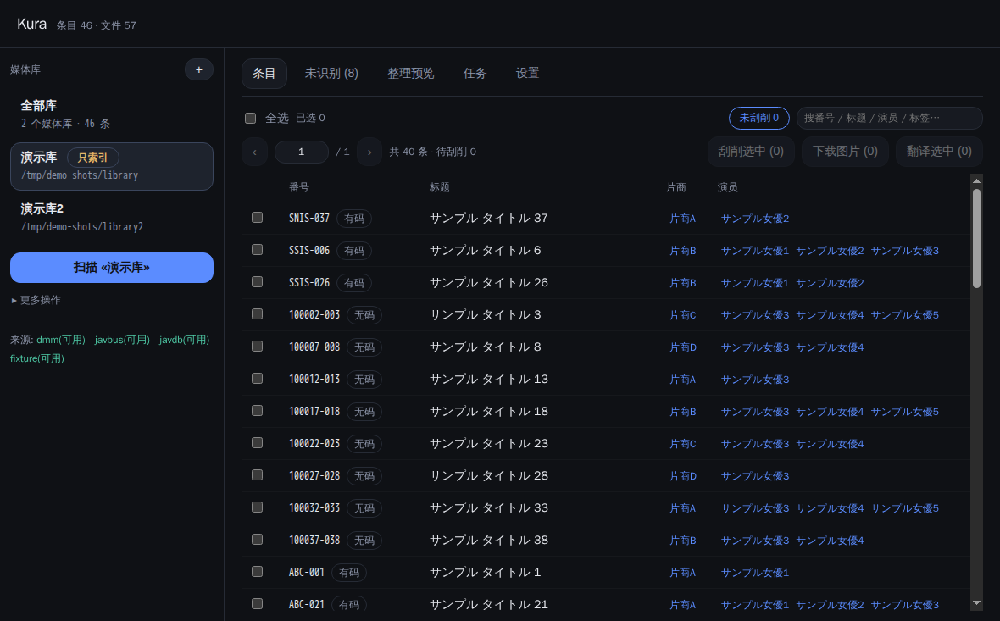
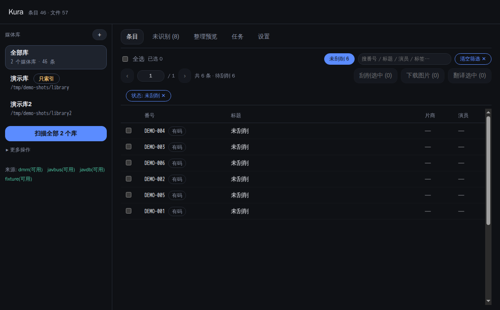
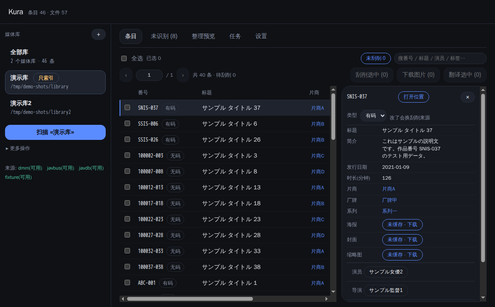
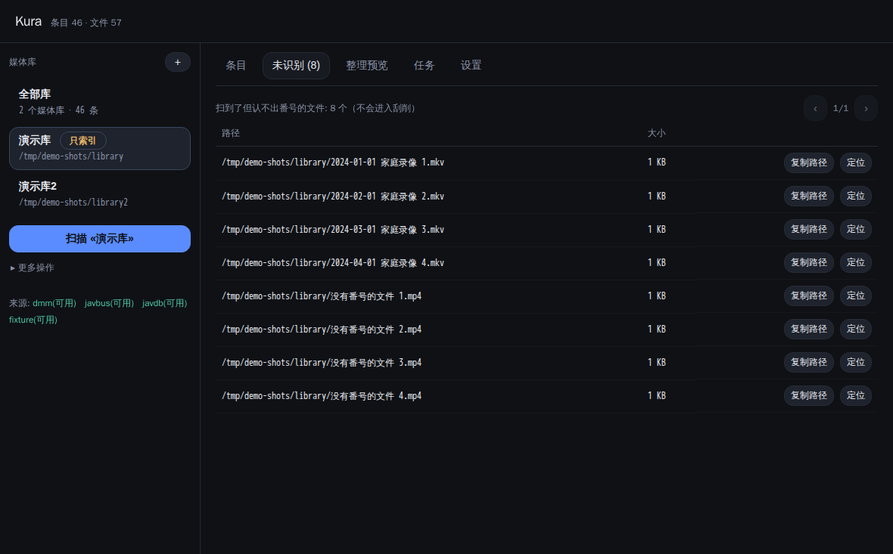
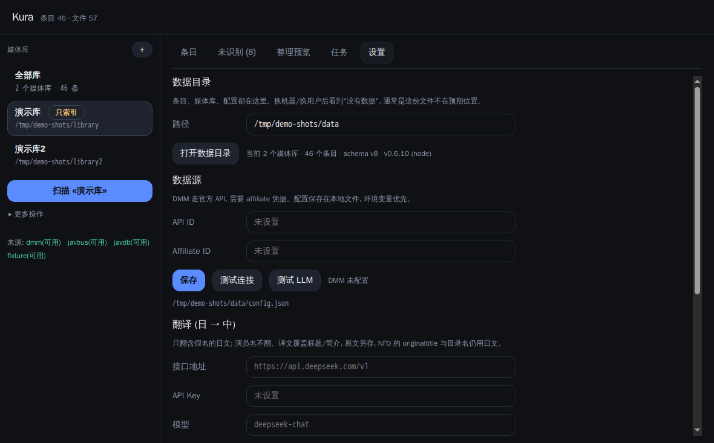
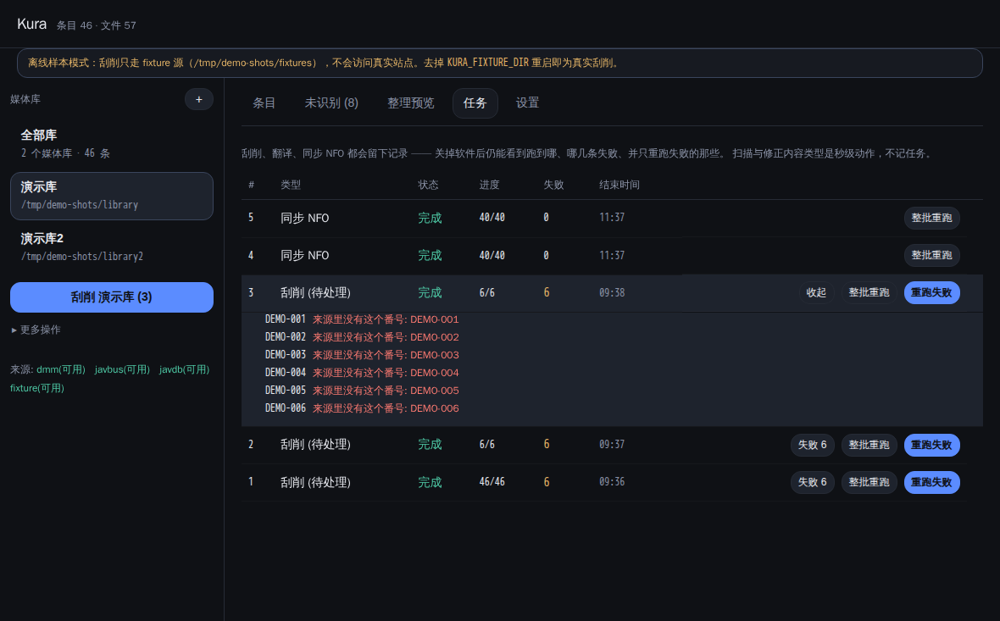

# Kura

番号制本地影片库管理器。**Electron 桌面应用 + 面向 agent 的 CLI**,共享一份 TypeScript core 和一个 SQLite 文件。

- 没有服务端、没有常驻进程:打开软件才运行,关了就退出。
- CLI 是单文件二进制,冷启动 ~40ms,零依赖。
- GUI 与 CLI 不通过端口通信,只共享同一个库文件。

领域词汇见 [CONTEXT.md](CONTEXT.md),产品边界见 [ADR 0002](docs/ADR/0002-产品边界.md),技术选型见 [ADR 0001](docs/ADR/0001-栈选择.md)。

> **适用范围**: Kura 是一个**元数据与文件整理工具**, 不提供、不托管、不下载任何内容。
> 它只读你本地已有的文件, 并为它们抓取公开可查的公开信息(标题、发行日期、演员等)。
> 请只用于你自己合法持有的内容, 并遵守所在地法律与服务条款。仓库里的截图全部来自
> `scripts/make-demo-data.mjs` 生成的假数据。

## 下载

最新版: **[Releases](https://github.com/p-nickzhang-q/kura/releases/latest)**

| 产物 | 说明 |
|---|---|
| `Kura-x.y.z-setup.exe` | Windows 安装包(选目录、桌面/开始菜单快捷方式、卸载器) |
| `Kura-x.y.z-portable.exe` | 免安装,双击即用 |
| `kura-x.y.z-win-x64.exe` | 命令行工具,给人和 agent 用 |

> 均**未签名**,Windows 会提示"未知发布者",点「更多信息 → 仍要运行」。
> 卸载**不会删除** `%APPDATA%\kura`(媒体库索引与配置)。

## 三个动作

| 动作 | 命令 | 碰什么 |
|---|---|---|
| REFRESH 扫描 | `kura scan <库>` | 只读磁盘:登记文件、解析番号、建条目占位 |
| SCRAPE 刮削 | `kura scrape <番号>` | 只读网络:各源取字段、逐字段择优、落库 + 存快照 |
| ORGANIZE 整理 | `kura organize <库>` | 默认只出计划;`--apply` 才移动文件并写 NFO |
| NFO 同步 | `kura nfo sync [库\|番号]` | 默认只出清单;`--apply` 才把库与视频旁的 `.nfo` 对齐 |

三个动作**互不触发**。没有"扫完自动刮""刮完自动整理"。

`nfo sync` 是**双向**的一次过:

- 库里没有网络来源 → 读 nfo 补空字段(换电脑、换硬盘就是这个场景);
- 库里有网络来源 → 把库的值写回 nfo, 只改 Kura 认识的字段(标题/演员/片商/标签…),
  别的工具写的 `<outline>` `<sorttitle>` `<poster>` 等**原样保留**;视频不动、不改名;
- 视频旁边没有 nfo → 新建一份 Emby 能读的。

`scan` **不读 nfo**(读入是 sync 的活), 但它会报「有 N 个条目的 .nfo 还没读进来」, 免得你不知道下一步。

nfo 只是**种子**: 它填的每个字段都标来源 `nfo`, 网络来源随时覆盖它; 网络这次没给的字段
再用 nfo 兜底, 所以重刮不会把 nfo 里对得上的演员抹掉。只有 nfo、从没联网刮过的条目, 仍算「未刮削」。
- **跳过 Emby 的辅助媒体**: `backdrops/theme_video.mp4`、`trailers/trailer.mp4`、`extras/` 这类文件不是影片,
  不登记也不会被同步 NFO 碰到 —— 否则会去改写 Emby 自己的元数据。
- **删除安全阀**: 一次扫描要移除超过 30% 的已登记文件时**中止**(退出码 4), 防止"网络盘没挂全"把索引清空。确认目录完整后重试, 确实要删就加 `--force`。

## 快速上手

```bash
kura library add 主库 ~/Videos
kura scan 主库
kura scrape ABC-123 --json
kura scrape --pending            # 批量: 逐条进度打到 stderr, Ctrl-C 可中断
kura scrape --pending --retry-failed   # 失败 3 次后不再自动重试, 用这个再试一轮
kura organize 主库              # 只看计划
kura organize 主库 --apply      # 真的移动

kura file list --unparsed       # 扫到了但认不出番号的文件(不会进刮削)
kura item list --limit 20 --offset 40   # 分页
kura item list --state unscraped        # 只看还没元数据的
kura item list --sort title --desc      # 按标题倒序; 空值永远排最后
kura file reveal ABC-123                # 这个番号在磁盘上的路径
```

## 整理维度

一个库选**一个**维度,决定第一层目录;模板负责其余层级。

| 预设 | 模板 |
|---|---|
| 按番号 / 按演员 / 按演员(全部) | `{number}` / `{actor}/{number}` / `{actors}/{number}` |
| 按片商 / 按厂牌 / 按系列 / 按类型 / 按年份 | `{studio}/{number}` … |

```bash
kura library set-template 主库 --dimension actor     # 按演员
kura library set-template 主库 --template '{actor}/{year}/{number}'
```

多值与路径的规则: `{actor}` 取第一演员,`{actors}` 全拼(`演员甲、演员乙`);`{title}` 用原文保证路径稳定,`{title_zh}` 才用译文。
目标已存在同名文件时**绝不覆盖**,计划里标 `skip`。

**旧成品库只索引(不整理)**: 允许扫描、搜索、刮削,永不移动、不改名、不建目录;
旁路文件(`.nfo`)的内容可用 `kura nfo sync` 显式对齐, 但它不会自己跑。

```bash
kura library add 旧片库 /path/to/library --no-organize
kura library set-organize 旧片库 --no-organize
```

## 数据源

| 来源 | 状态 | 说明 |
|---|---|---|
| `dmm` | **可用** | DMM/FANZA 官方 API,需 affiliate 凭据 |
| `javbus` | **可用** | 网页解析(真实页面验证过) |
| `javdb` | **可用** | 网页解析。注意它现在在 **Cloudflare 挑战**后面:机房 IP 大概率 403,换住宅节点可解;**无码条目需登录** |
| `fixture` | 可用 | 从目录读离线样本,用于开发与测试 |

```bash
kura config set --dmm-api-id ... --dmm-affiliate-id ...   # https://affiliate.dmm.com/api/
kura source test dmm                  # 一条命令验证凭据与解析
kura source test javbus
kura scrape ABC-123                   # 默认路由: dmm → javbus → javdb
kura scrape ABC-123 --source javbus,javdb   # 双源逐字段择优
```

缺凭据时退出码是 **4(NEEDS_INPUT)**,不会静默返回空条目。

## 海报

```bash
kura resource fetch ABC-123   # 下载到本地缓存(带防盗链 Referer)
```

下载后**同时复制一份到视频旁边**:`<视频名>-poster.jpg` / `<视频名>-thumb.jpg`,换播放器/换机器都认。
不想要就 `kura config set --no-save-images`。库里有缓存图时,NFO 的 `<thumb>` 写的是相对文件名。

## 翻译(日 → 中)

**翻什么**:只有两样 —— 标题(`title`)和简介(`plot`)。演员、片商、系列、标签、导演一律不翻。

**什么才翻**:含假名(平假名/片假名)的日文才翻。纯汉字的中文标题、英文标题原样不动 ——
少一道无意义的模型调用,也免得"标题被翻译腔改坏"。演员不翻是因为人名音译没有唯一答案,
而且会污染目录名。

```bash
kura config set --llm-base-url https://api.deepseek.com/v1 --llm-api-key sk-... --llm-model deepseek-chat
kura config set --translate          # 刮削后自动翻
kura translate --pending             # 补历史条目
```

任何 OpenAI 兼容端点都行(DeepSeek / 通义 / Ollama / LM Studio)。译文缓存独立在 `<数据目录>/translations.db`,删掉即重翻。

## 界面

### 条目



- **范围跟着左侧选中的库走**:列表、计数、扫描、未识别都只算这个库。顶上的「全部库」是伪条目,选中它范围回到全库,「扫描」会按顺序逐个扫。
- 主按钮写清范围 —— `扫描 «电影库»` 和 `扫描全部 3 个库` 是两件事,不靠猜。
- 列:番号(带类型徽标)、标题、片商、演员。标题列点表头排序(升 → 降 → 取消),空值永远排最后。
- 搜索框输入即搜,匹配番号 / 标题 / 原名 / 片商 / 系列 / 导演 / 演员 / 标签。



「未刮削 N」只筛**还能自动重试**的那批;**试满 3 次的单独算「需手动重试 M」**(两个数字都能点,
点进去的行数与数字一致)。只被 NFO 种过、从没联网刮过的条目也算在里面 —— 那批的演员/片商
还是旧库的值,等网络来源来盖。想再试一次: 点「需手动重试」→ 勾选 → 「刮削选中」。

筛选条件以 chip 列在下方,点一下取消。

### 详情



- 每个字段按来源分别记录(`javbus` / `javdb` / `dmm`),鼠标悬停该行才显示来源与锁按钮;锁住的字段重新刮削不会被覆盖。
- **类型**是下拉:解析器判错时人可以直接改,不用等扫描。
- 「打开位置」在资源管理器里定位文件;图片字段没缓存时给「未缓存 · 下载」,缓存了就能点开看大图。

### 未识别



扫到但认不出番号的文件单独一页,不会进入刮削。每行可复制路径或定位到文件夹 —— 认不出多半是命名问题,改完文件名再扫一次即可。

### 设置



数据目录(换机器后「没有数据」通常是这份文件不在预期位置)、DMM 凭据、翻译端点与开关、代理(带「测试代理」:一次报出配置值 / 实际生效 / 哪些端口在监听)、各来源状态。

### 任务



刮削、翻译、同步 NFO 都会留下一条任务:跑到第几条、失败几条、什么时候结束。

- **当前任务**:正在跑的那条在最上面,带进度条和「停止」
- **失败详情**:点「失败 21」展开,逐条列出番号与原因(`EBUSY 文件被占用`、`路径超长`…)
- **重跑失败**:只重跑上一条任务里失败的番号,不重扫整库;另一个按钮才是整批重跑

扫描和「修正内容类型」不进任务 —— 前者只读磁盘、有自己的进度,后者是一次批量 SQL,秒级。

五个页签:**条目 / 未识别 / 整理预览 / 任务 / 设置**。侧栏只有一个主按钮,按状态推导:有待刮削 → `刮削 «库名» (N)`,否则有待翻译 → 翻译,否则 → 扫描;其余动作收在「更多操作」(含「强制扫描」与「修正内容类型」)。界面在加载时给骨架屏、长任务给进度条,`prefers-reduced-motion` 下全部退化。

## 任务与日志

批量操作会留下一条任务记录（进度、失败数、中断状态），关掉软件后仍能查到并重试：

```bash
kura task list              # 最近的任务
kura task show 3            # 详情 + 日志文件路径
kura task retry 3           # 重新入队（用 scrape --pending 继续）
```

日志在 `<数据目录>/logs/tasks/*.jsonl`（JSONL，已脱敏），GUI 的「任务」页也能看并点重试。

## 手动改字段与锁定

```bash
kura item set ABC-123 --title "我改的标题" --plot "我改的简介"   # 默认自动锁定
kura item lock ABC-123 title,plot
kura item unlock ABC-123 title
```

锁定的字段重新刮削不会被覆盖。

## 内容类型判错了怎么修

类型决定**刮削路由**(国产只走 javdb,有码走 dmm→javbus→javdb)和整理目录里的 `{content_type}`。
它按设计"建条目时落定、之后不可改",但解析器有 bug 时历史数据必须能修:

```bash
kura item retype --detect            # 按当前解析器列出所有判错的条目(不动数据)
kura item retype --detect --apply    # 确认后真的改
kura item retype SSIS-915 censored   # 单条
```

界面里同一个功能有两处:详情面板的「类型」下拉(单条),「更多操作 → 修正内容类型」(批量,会先弹清单让人确认)。

扫描时也会自动修 —— 但**只动从没刮过网络的条目**(`field_sources` 为空)。已经刮到字段的留给人定,
因为换类型等于换来源线,开着整理时还会按新类型挪目录。

## 代理

- **留空**: 跟随系统代理 —— Clash 开系统代理或 TUN 即可,无需配置。
- **`auto`**: 启动时 TCP 探测 7890/7891/7897/1080/10808/20171,选第一个有人在听的;都没有才退回系统代理。GUI 与 CLI 都支持。
- **显式地址**: `http://127.0.0.1:7890`。手写 `127.0.0.1:7890`(不带 scheme)会自动补 `http://`,`socks://` 统一成 `socks5://`。
- 优先级: `KURA_PROXY` > 配置文件 > 系统代理/直连。

设置页有「**测试代理**」,一次报出三个值:配置的是什么、实际在用的是什么、哪些常见端口在监听。

两类错误要分清:`ERR_PROXY_CONNECTION_FAILED` 是"请求被送去代理但端口没人听"(代理软件没开);
`HTTP 403` 是"请求到了站点、站点拒绝"(地区限制 / Cloudflare 风控 / 要登录),后者退出码 4 并附具体建议。

WSL 里指向宿主机 Clash 要用网关地址,`auto` 会自动探测。

## 开发

前置: [Bun](https://bun.sh) ≥ 1.1、[pnpm](https://pnpm.io) ≥ 9。网络受限时加
`ELECTRON_MIRROR=https://npmmirror.com/mirrors/electron/`。

```bash
# 造一批测试数据(假文件 + 离线样本), 不碰真实站点
node scripts/make-demo-data.mjs --count 40 --out ./demo-data
node scripts/make-demo-data.mjs --numbers "SSIS-001,MIDV-001" --out ./demo-real   # 假文件 + 真站点

bun run cli --help               # 零 install 跑 CLI
pnpm install && pnpm dev         # 桌面端
bun test                         # 193 个用例, 全部离线
bun run build:cli                # -> dist/kura
bun run build:cli:win            # -> dist/kura.exe
pnpm --filter @kura/desktop package:installer   # NSIS 安装包 (Linux 上需 wine)
pnpm --filter @kura/desktop package:win         # portable (无需 wine)
```

打包细节(含无 sudo 时的 Windows 侧构建、离线缓存)见 [docs/dev/packaging.md](docs/dev/packaging.md);
发版流程与产物核对见 [docs/dev/release.md](docs/dev/release.md)。

## 目录

```
packages/core      业务逻辑 + SQLite (唯一有状态的一层)
  domain/          纯函数: identify / aggregate / materialize / dimensions
  sources/         来源接口、路由、javbus / javdb / dmm API、fixture
  llm/             翻译客户端与缓存
  tasks/           scan / scrape / organize / translate / resources
  db/              schema 迁移、行映射、演员索引
packages/cli       面向 agent 的 CLI (契约见 docs/dev/cli-contract.md)
apps/desktop       Electron 主进程 + Vue3 界面
docs/dev           给 agent 的架构与契约
```

## 退出码

`0` 成功 · `2` 用法错 · `3` 可重试 · `4` 需要人 · `5` 不存在 · `10` 内部错误

`kura schema --json` 输出机器可读的命令清单,与参数解析共用同一份声明。

## 许可证

[MIT](LICENSE)。

## 数据来源与署名

- 番号制来源:DMM / JavBus / JavDB(见 `docs/dev/sources.md`)
- 普通影视来源:**TMDB**

> 本产品使用 TMDB API,但**不代表或受 TMDB 认可**。
> This product uses the TMDB API but is not endorsed or certified by TMDB.

## 致谢

数据来源是各家公开站点与官方 API, 解析器与任务模型的设计参考了
[Amane](https://github.com/sqzw-x/amane) 的思路(但范围收窄了很多)。
